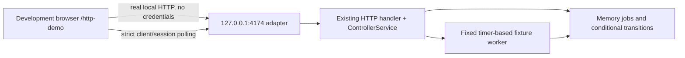

# Local HTTP fixture demo

Status: 2026-10-24, local development only. No public deployment or live-data
entitlement is implied. The default dashboard remains the in-memory contract
demo; the production build has no local HTTP transport.

## Start and stop

From the project root, with the supported Node and pinned pnpm installed:

```text
pnpm demo:local-http:plan
pnpm demo:local-http
```

The first command starts nothing. The second binds the existing guarded Vite
development server to `127.0.0.1:5173` and a fixture API to `127.0.0.1:4174`.
Open **http://127.0.0.1:5173/http-demo**. Only that exact development URL (and
its `#main-content` skip-link fragment) selects HTTP mode. The banner identifies
the mode in all three languages. Normal `/` remains the in-memory demo.

Enter `stop` or press Ctrl+C in the starting terminal to close both owned
children. Closing its standard input also requests closure. Both servers have
a five-minute lifetime; the supervisor has a 330-second failure backstop, not
an extension of normal serving time. A new invocation starts an empty memory
repository. The wrapper refuses an occupied fixed port; it does not kill another
application or silently choose a different port.

For API-only inspection, `pnpm demo:local-api:plan` is inert and
`pnpm demo:local-api` explicitly starts only the fixed loopback fixture API.
Its standard input, stop signals and five-minute lifetime are also bounded.

## What is actually connected



Requests use the actual schema/allowlist/idempotency/controller/public-response
logic. The worker, repository, circuit selection and market/analysis results
are **synthetic local dependencies**, not ECS, DynamoDB, Twelve Data or Bedrock.
The AWS factory is never called; importing the handler's adapter definitions
does not instantiate an AWS client. A successful response is displayed only if
its result exactly matches the reviewed local contract fixture. No live result
is silently substituted or relabelled as a demo.

This mode exercises browser CORS, HTTP serialization, strict client validation,
job context, polling and rendering. It does **not** exercise IAM/SigV4, cloud
infrastructure, actual provider/model latency, billing stop or public-user auth.

## Resource and trust boundaries

- Loopback IPv4 only; exact Host, route and Origin checks. CORS allows only the
  exact development origin, GET/POST and three fixed request headers. No wildcard
  or credentialed CORS, proxy, upstream override or arbitrary file server.
- Fetch omits credentials/referrers and refuses redirects. The API rejects
  cookies, authorization and AWS-token headers rather than using them.
- Maximum 512 requests, 32 newly admitted jobs, one active job, 4,096 body bytes,
  8,192 header bytes and 16 simultaneous connections per server instance.
  Requests beyond the total ceiling return 429; they never launch cloud work.
- Five-minute expiry and explicit closure clear memory jobs and timers and
  close connections. This is bounded local cleanup, not remote cancellation.
- Synthetic success, unavailable, timeout, circuit-open and launch-failure paths
  exist. The UI exposes its existing reviewed scenario set; the API launch-failure
  scenario is tested independently. No scenario enables a real worker.
- The supported CLI children receive filtered environments, not inherited cloud
  credentials or compiler/preload overrides. The Vite environment/file-boundary
  guard remains unchanged. Do not put secrets in fixtures or the frontend.
- Loopback and CORS are not authentication against another local process. The
  service deliberately contains no sensitive data or privileged capability;
  do not re-use it as a public backend or bind it to a LAN interface.

## Verification and limits

Focused tests cover the API boundary, replay/conflict, negative results,
cancellation, fixture identity and inert default CLI plans. The opt-in
`scripts/probes/local-fixture-api.probe.ts` performs the 30 intent combinations
and the real job/request ceilings; it is not recursively started by routine
unit tests. Browser observations and whole-source frozen-install receipts have
their own dated scopes in [the implementation evidence](evidence/LOCAL_HTTP_AND_GIT_PROOF_2026-10-24.md).

The explicit `node --test scripts/probes/local-http-lifecycle.probe.mjs` checks
an owned strict-port collision: startup failure closes both demo children without
stopping the listener already using that port. Routine lifecycle unit tests also
check factory/listen/close failures, EOF and duplicate stop signals without binding
ports. Neither probe is an automatic startup or public-hosting acceptance.

Production-artifact tests inspect every emitted JavaScript asset for the local
API address, scenario header and development URL/transport marker. Passing them
does not establish complete visual/accessibility, license or publication review.

## Independent installed Node and Git locations

The opt-in tracked-clone proof normally locates Git beside the selected Node
runtime bundle. When the supported Node and trusted installed Git live in
different bundles, pass the explicit absolute Git executable path:

```text
node scripts/local-git-clone-proof.mjs --execute-local-git-frozen-proof --git-executable C:\tools\Git\cmd\git.exe
```

The sample path is illustrative, not an instruction to download/install a tool.
Choose the supported Node and existing trusted Git actually verified on the
machine. The option is accepted only with the execution flag, never from an
environment override or PATH search. It rejects relative paths, repository-local
tools, non-regular/linked files and command-line suffixes. Physical file validation
does not establish publisher identity. The original Git repository, global
configuration and all existing isolation/version/time bounds remain unchanged.
