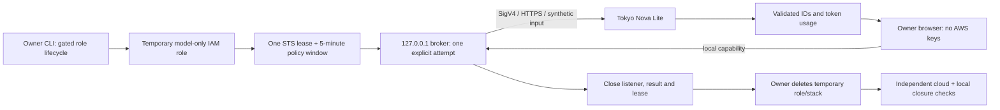
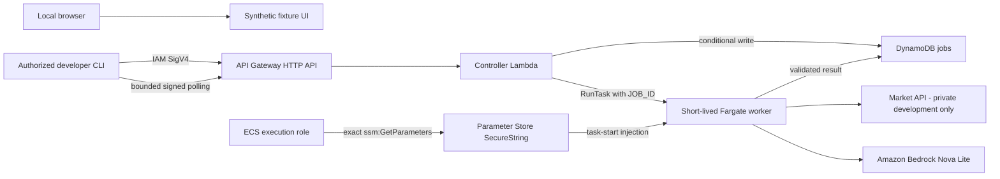
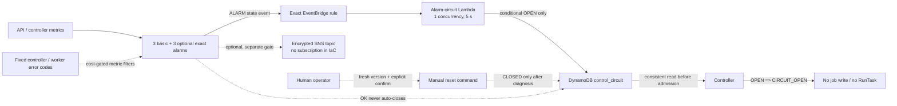

# Architecture

## Synthetic AWS exercise — ADR 0020 / 0021, verified 2026-10-31

Search companion → plain loopback link → protected 5-minute local broker →
HTTPS/SigV4 Tokyo Bedrock Nova Lite → validated insight IDs → localized browser
result. Browser carries a short-lived local capability, never AWS credentials.
Input is one invented QLD snapshot; result is held in memory only. One attempt,
no retry, no public listener, no provider, no Fargate or durable deployment. Existing
AWS pipeline below remains retained but is not claimed as this exercise's path.
[Decision](adr/0020-synthetic-bedrock-local-lab.md), [runbook](runbooks/synthetic-bedrock-lab.md).

The owner CLI verifies source/identity/idle posture and creates one owned
temporary model-only role. After four exact policy reads, one STS assumption
supplies only that restricted lease to the model SDK. The owner key is not
exported to it. A session policy limits authorization to an absolute five-minute
window inside the 15-minute STS credential lifetime. The application separately
consumes a one-attempt allowance, including failures.

This role is not a permanent installation. The existing API/Fargate circuit
does not govern every direct Bedrock call; the direct path has its own gates.
Local process compromise remains in the trusted-PC threat boundary. Historical
proofs must not be reused after source changes or treated as universal revocation.
[Observed browser result and teardown](evidence/SYNTHETIC_RESTRICTED_BROWSER_2026-10-31.md).

## Active product path — 2026-10-25, ADR 0019

Local fixed-symbol/locale selection → visible question → explicit clipboard copy
→ ordinary ChatGPT tab → owner paste/send → result stays in ChatGPT.
There is no data API, AWS dispatch, ChatGPT session integration or response import
in this path. Existing AWS architecture below is a separate retained private lab;
the optional dashboard is a local synthetic simulation, not live market access.
[Decision and boundaries](adr/0019-chatgpt-search-companion.md).

## Earlier access change — 2026-10-25, retained API observation path

That earlier target was trusted-owner loopback UI → short-lived local broker → HTTPS
IAM/SigV4 AWS API. No domain is purchased; CloudFront hosting and hosted-session
authentication are deferred. The initial diagnostic serves a validated catalog/
health snapshot, not live prices or the full product. The existing event-driven
AWS backend remains. [ADR 0017](adr/0017-local-owner-aws-bridge.md) and
[bounded local observation](LOCAL_OWNER_OBSERVATION.md) define the exact boundaries.
The historical fixture/cloud diagram below is not the new browser acceptance proof.

## Historical event-driven cloud path and offline simulator

The cloud path below records prior bounded acceptance, not a fresh account audit.
The simulator is a **synthetic local demo** with no live
connection to the IAM-protected API. This is distinct from the actual synthetic
Bedrock browser path documented first. Neither a CloudFront site nor operational
alarms, notifications, or a recurring sweeper were deployed in this checkpoint.

The 2026-10-24 default UI validates in-memory contract responses through the
actual client/session. A separate, development-only `/http-demo` exercises real
loopback HTTP/CORS with the same handler/controller and fixed in-memory
dependencies. Its API expires after five minutes and has no AWS/provider/model
capability. That transport is absent from emitted production JavaScript; it is
not a public backend or a bridge to the cloud path below.
[Local mode and exact limits](LOCAL_HTTP_DEMO.md).

## Separate future gates (not deployed)

- A fixture-only public portfolio site would require approved private S3/OAC,
  CloudFront, TLS/domain behavior, costs, sanitized assets, publication rights,
  rollback material, and live HTTPS verification. Its static browser bundle
  would **still not** call the IAM API.
- A real end-user market product would additionally require a reviewed user
  authentication/authorization design and explicit market-data external-display
  rights. CORS by itself is not authentication; no AWS credential belongs in
  the browser.
- The CloudWatch dashboard/alarms and Lambda/EventBridge maintenance schedule
  are separate opt-in local drafts. The alarms have actions disabled and the
  proposed maintenance schedule is disabled. SNS notification and automatic
  circuit opening are separate, undeployed drafts with independent gates. The
  automatic path is one-way (`OPEN` only), exact-alarm filtered and absent from
  default synthesis; deployment still needs a fresh security/cost decision.

### Operations control flow draft

The diagram below is a locally tested design, not a deployed-state claim. Solid
arrows show the one-way alarm response. The dotted paths remain human-controlled
or independently gated.

The control Lambda receives neither ECS nor provider/model permissions. A
delivery or execution retry can duplicate an event, so the first read and
conditional version write make OPEN idempotent. False alarms can reduce
availability, but they cannot automatically re-enable spending.

The three optional counters contain no dimensions: task-launch, provider and
model failures are selected only by fixed structured-log codes. They are absent
from default synthesis because CloudWatch Logs metrics are billable custom
metrics; job/request IDs and arbitrary errors never become metric identities.

## Trust boundaries

- Browser: untrusted input and rendering boundary; no secret or privileged AWS credential.
- Controller: schema, allowlist, idempotency, circuit, rate-limit boundary.
- Worker: outbound provider/model access and untrusted response normalization boundary.
- ECS execution role: image pull, log delivery, and exact provider-key injection only; application code does not receive these AWS permissions.
- Worker task role: exact jobs-table and Nova Lite invocation only; no task launch, PassRole, or Parameter Store read permission.
- Controller role: exact job-table and task-launch/PassRole permissions; no provider-secret or Bedrock access.
- DynamoDB: `jobId` keyed on-demand table, TTL on `expiresAt`, consistent worker reads, and `status + version` conditional state authority; terminal records are immutable.
- Operations: proposed exact-task stop authority is currently a local draft.
  Manual circuit reset remains distinct from the automatic response; the latter
  can update only the exact circuit item to `OPEN` and has no reset authority.

## Non-negotiable properties

- Main stack has no ECS Service, ALB, or NAT Gateway.
- API returns `202` before provider or model work begins.
- One image supports `PRICE` and `ANALYZE`; one task handles one `JOB_ID` and exits.
- A task must claim `QUEUED → RUNNING` before provider/model work; duplicate or expired claims make no external call.
- Public-subnet task has no inbound rules or listener.
- The provider secret value is created outside IaC and never appears in source, task overrides, image layers, outputs, or templates.
- `marketDataUsageMode` remains `internal-development-only` and public live quotes remain disabled until dated external-display rights are documented.
- Status flow is `QUEUED → RUNNING → SUCCEEDED|FAILED|TIMED_OUT`.
- Frontend remains statically exportable for a future private S3 + CloudFront
  OAC site; this is not evidence that a public site has been deployed.

## Local mode

The local UI and worker use synthetic fixtures. They exercise contracts and user states but deliberately do not claim live integration evidence.
